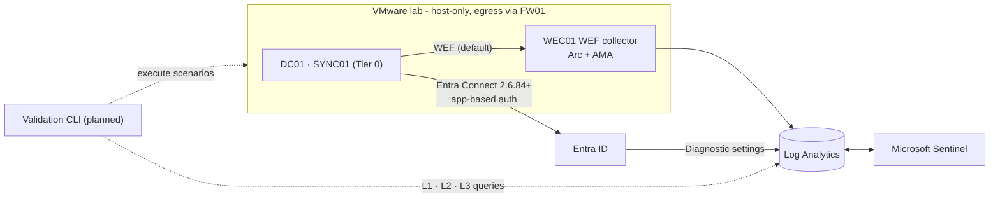

# Hybrid Detection Validation

**Continuous security detection validation for hybrid Active Directory and Microsoft Entra ID / Azure environments.**

The goal is a platform that executes controlled, reversible attack scenarios in an **isolated
lab** and proves, with stored evidence, whether each Microsoft Sentinel detection works end to
end. It is designed to evaluate every run in three layers:

| Layer | Question |
|---|---|
| **L1 Telemetry** | Did the expected raw events reach Log Analytics? |
| **L2 Logic** | Does the rule's KQL match those events? |
| **L3 Alert** | Did Sentinel raise the alert, attributable to this run? |

Each run will yield **PASS**, **FAIL** (detection gap) or **INCONCLUSIVE** (telemetry, licensing
or lab-state gap), so broken pipelines are not mistaken for broken detections. Detection
maturity will be **derived from that evidence**, never declared.

> **Current status: Phase 0 (foundations), revision 2, in review.**
>
> **Implemented and tested locally:** schemas, a hardened content validator (pinned ATT&CK 20.1
> and a licensing matrix), malicious-input tests, the fail-closed lab state, the idempotent
> sweeper, evidence-based maturity, an Arc lockdown script, isolation readiness checks, and CI.
>
> **Not done yet:** no Azure resources are deployed, no detection exists or has been validated,
> no KQL has been executed, no attack simulation has run, and the CI workflow has not yet run on
> GitHub. See the [roadmap](docs/roadmap.md).

## Architecture at a glance



Full design: [docs/architecture.md](docs/architecture.md)

## Stack

| Area | Technology |
|---|---|
| On-premises | AD DS on VMware; isolated host-only network with a firewall VM; Entra Connect Sync ≥ 2.6.84.0 (application-based authentication) on a dedicated member server |
| Telemetry | Azure Monitor Agent via a WEF collector (default), or Azure Arc on Tier 0 machines only inside a dedicated Tier 0 subscription; Data Collection Rules; Entra diagnostic settings |
| Detection | Microsoft Sentinel, KQL, YAML content model, MITRE ATT&CK (Enterprise 20.1, pinned) |
| Simulation | Atomic Red Team (pinned commit), PowerShell, Microsoft Graph, Azure CLI (planned) |
| Validation | Python CLI, SQLite, Markdown/HTML reports (planned; safety core implemented) |
| IaC | Terraform (Azure), PowerShell (Windows Server / AD DS) |
| CI/CD | GitHub Actions: Python 3.12, hash-locked dependencies, actionlint, gitleaks, Dependabot; OIDC planned for Phase 5 |

## Repository layout

```
.github/            CI workflow (validate) and Dependabot
detections/         Detection content (DET-*.yml) - Phase 3
scenarios/          Attack scenarios (SCN-*.yml) and executor scripts - Phase 4
schemas/            JSON Schemas: detection and scenario contracts
tools/              Content validator, ATT&CK data generator, reference data (tools/data/)
tests/              Unit tests, valid fixtures, malicious fixtures
infra/terraform/    Azure infrastructure - Phase 1
lab/powershell/     Arc lockdown and isolation checks (implemented); more in Phase 2
validator/hdv/      Validation engine: lab state, sweeper, maturity (implemented); rest Phase 4
docs/               Architecture, network, DCSync design, threat model, safety, ADRs, roadmap
```

## Documentation

| Document | Content |
|---|---|
| [Architecture](docs/architecture.md) | Components, engine design, identities, OIDC and Azure scopes |
| [Lab network](docs/lab-network.md) | Host-only network, firewall VM, isolation readiness checks |
| [Data flow](docs/data-flow.md) | Telemetry paths, audit prerequisites, run sequence, data handling |
| [DCSync design](docs/dcsync-detection-design.md) | 4662/4624 correlation, SACL, tuning, volume |
| [Threat model](docs/threat-model.md) | STRIDE for the platform + ATT&CK scope |
| [Safety](docs/safety.md) | Rules of engagement, guardrails, snapshot restoration risks |
| [Lab requirements](docs/lab-requirements.md) | Read-only discovery checklist and readiness gates |
| [Hybrid identity](docs/hybrid-identity.md) | Entra Connect Sync design; Cloud Sync alternative |
| [Cost & licensing](docs/cost-and-licensing.md) | Cost model, trial plan, portal vs export, licensing gates |
| [Roadmap](docs/roadmap.md) | Phases, gates, exit criteria, MVP definition of done |
| [ADRs](docs/adr/README.md) | Architecture decision records |

## Local validation

Create a virtual environment, then install the hash-locked dependencies:

```bash
python3.12 -m venv .venv && . .venv/bin/activate
```

```bash
python -m pip install --require-hashes -r requirements-dev.txt
```

```bash
yamllint --strict . && actionlint && python tools/validate_content.py
```

```bash
python -m pytest -q tests
```

The PowerShell tests run when PowerShell 7 (`pwsh`) is on `PATH`, or `HDV_PWSH` points to it;
otherwise they are skipped. Secret scanning uses gitleaks:

```bash
gitleaks dir --config .gitleaks.toml --redact .
```

## Safety

This repository will contain adversary-emulation content intended **only** for an isolated lab
tenant, subscription and VMware network owned by the operator. Read
[docs/safety.md](docs/safety.md) before running anything.

## Licence

No licence has been chosen yet. The owner will decide before the repository is made public.
