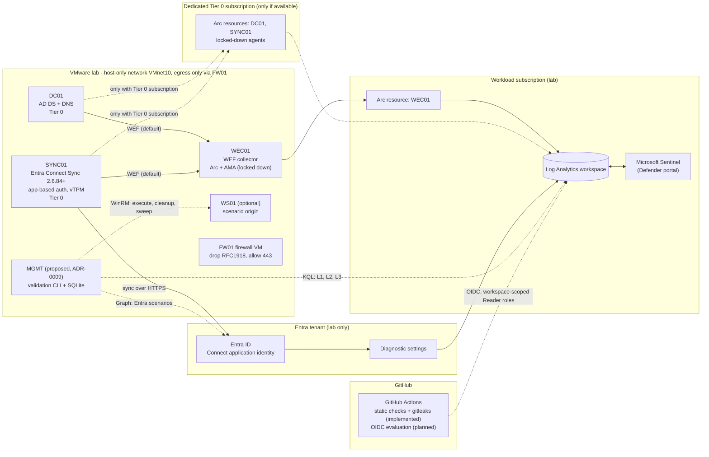

# Technical Architecture

> **Status:** Phase 0 design (revision 2, after the Phase 0 review). **Nothing described here
> is deployed.** Components are marked **implemented**, **planned** or **proposed**. Vendor
> behaviour marked **(verify)** is unconfirmed. No Azure, Sentinel or KQL integration has been
> tested.

## 1. Purpose

Continuously prove, with evidence, that detections for hybrid Active Directory and Microsoft
Entra ID attacks work, and catch regressions when detections, telemetry or the platform change.

For each detection, the platform will repeatedly answer:

> *When this technique is executed in the isolated lab, does the expected telemetry arrive,
> does the rule logic match it, and does Sentinel raise the alert within a bounded time?*

### Non-goals

- Not a production SOC; never used against production or third-party tenants.
- Not a replacement for Defender for Identity or Defender XDR (out of MVP scope).
- No hosted web UI in the MVP ([ADR-0005](adr/0005-mvp-stack-python-cli-sqlite.md)).

## 2. Design principles

1. **Evidence over assertion.** Verdicts store the queries and rows that justify them. Maturity
   is derived from evidence ([ADR-0014](adr/0014-maturity-derived-from-evidence.md)).
2. **Separate telemetry gaps from detection gaps** ([ADR-0008](adr/0008-three-layer-verdict-model.md)).
3. **Portal independence:** data-plane APIs only; incidents are validated separately
   ([ADR-0006](adr/0006-portal-independent-validation-engine.md)).
4. **Tier 0 stays Tier 0:** the Azure control plane only touches DCs inside a dedicated Tier 0
   subscription; otherwise WEF is used ([ADR-0011](adr/0011-tier0-arc-isolation-wef-fallback.md)).
5. **Isolation and fail-closed safety:** host-only network with a firewall VM; lab state blocks
   runs after any failed cleanup ([ADR-0012](adr/0012-lab-network-isolation.md),
   [ADR-0013](adr/0013-lab-state-cleanup-sweeper.md)).
6. **Licensing is data, with empirical gates** ([ADR-0007](adr/0007-licensing-and-cost-guardrails.md)).
7. **Content is untrusted input** and safety invariants live in the schema
   ([ADR-0010](adr/0010-content-as-code-yaml-schemas.md)).

## 3. Architecture overview

Solid lines are the default design. Dashed lines are conditional or proposed.



Every lab VM reaches the internet only through FW01. Detailed flows are in
[data-flow.md](data-flow.md); the network design is in [lab-network.md](lab-network.md).

## 4. Components

| Plane | Component | Responsibility | Managed by | Status |
|---|---|---|---|---|
| Lab | FW01 | Only egress; drops RFC1918; allows TCP 443 | Firewall config + readiness checks | Planned (Phase 2); checks **implemented** |
| Lab | DC01 | Existing AD DS DC; audit policy + SACL for detections | PowerShell (dedicated GPO) | Planned (Phase 2) |
| Lab | SYNC01 | Entra Connect Sync ≥ 2.6.84.0, application-based authentication, vTPM recommended | Runbook + PowerShell | Planned (Phase 2) |
| Lab | WEC01 | WEF collector (default telemetry path for Tier 0 machines) | PowerShell + Arc + AMA | Planned (Phase 2) |
| Lab | WS01 | Realistic origin for AD attacks | PowerShell | Optional |
| Lab | MGMT | Runs the validation CLI inside the lab | — | Proposed ([ADR-0009](adr/0009-scenario-execution-path.md)) |
| Azure | Arc agents | Lockdown applied before connect | [`Set-HdvArcAgentLockdown.ps1`](../lab/powershell/arc-onboarding/Set-HdvArcAgentLockdown.ps1) | Script **implemented** (untested on a real agent) |
| Azure | DCRs | XPath-filtered collection (direct or forwarded events) | Terraform | Planned (Phase 2) |
| Azure | Workspace + Sentinel | Telemetry, alerts, incidents | Terraform | Planned (Phase 1) |
| Entra | Diagnostic settings | AuditLogs (gate LIC-001), sign-ins if licensed | Terraform | Planned (Phase 2) |
| Content | Schemas, validator, reference data | Contracts, hardened validation, ATT&CK 20.1, licensing matrix | Python | **Implemented** |
| Engine | Lab state, sweeper, maturity | Fail-closed safety core | Python (`validator/hdv/`) | **Implemented** (offline, with fakes) |
| Engine | CLI, executors, evaluation, storage, reports | Validation loop | Python | Planned (Phase 4) |
| CI | `validate` workflow | Lint, schemas, content, tests on Python 3.12, actionlint, gitleaks | GitHub Actions | **Implemented** (not yet run on GitHub) |

## 5. Validation engine design (Phase 4, planned)

### 5.1 Run lifecycle

```
lock → require CLEAN → plan → pre-flight → execute → cleanup → evaluate (L1→L2→L3) → incident check (if expected) → persist → report → unlock
```

- **Lock and lab state:** acquire the run lock; refuse unless the lab is CLEAN.
- **Plan:** resolve scenario ↔ detection pairs from YAML; refuse anything not lab-only.
- **Pre-flight (fail closed):**
  - tenant ID and AD domain match the local inventory;
  - isolation checks are recent;
  - every required table is fresh;
  - the rule exists and is enabled;
  - licensing gates are closed;
  - manual approval is given where required.
- **Execute:** inject `HDV-<run_id>`; capture UTC timestamps and exit status.
- **Cleanup:** always attempted. Any failure marks the lab DIRTY ([ADR-0013](adr/0013-lab-state-cleanup-sweeper.md)).
- **Evaluate:** poll with backoff until the detection's timeout.
- **Incident check:** only if `validation.incident.expected`; reported separately.
- **Persist:** SQLite (`runs`, `executions`, `layer_evidence`, `verdicts`, `incident_checks`).
- **Report:** Markdown/HTML, ATT&CK layer, maturity derived from evidence.

### 5.2 Reason codes for INCONCLUSIVE

| Code | Meaning |
|---|---|
| `LAB_NOT_CLEAN` | Lab state is DIRTY, UNINITIALISED or unreadable |
| `PREFLIGHT_TENANT_MISMATCH` | Credentials point to a tenant or domain not in the lab inventory (run aborted) |
| `PREFLIGHT_ISOLATION` | Isolation readiness checks missing, stale or failing |
| `PREFLIGHT_TELEMETRY_STALE` | A required table has no recent data |
| `PREFLIGHT_RULE_MISSING` | Rule not deployed or disabled |
| `LICENSING_GATE_OPEN` | The detection depends on an unresolved licensing gate |
| `EXECUTION_ERROR` | Scenario failed to run (for example, blocked by antivirus) |
| `L1_TIMEOUT` | Expected raw events never arrived |
| `INGESTION_CAPPED` | Workspace daily cap reached |
| `ADAPTER_ERROR` | Alert-source API error or throttling |

### 5.3 Defender portal compatibility

Alert evidence comes from `SecurityAlert` (data plane), which is independent of the portal and
of incident creation. Incident creation is an explicit per-rule property and is validated only
when expected. A Graph security API adapter is planned post-MVP
([ADR-0006](adr/0006-portal-independent-validation-engine.md)).

## 6. Identities, OIDC and Azure permissions

| Identity | Used by | Scope | Permissions (least privilege) | Status |
|---|---|---|---|---|
| Owner (human) | Manual administration | Lab subscriptions + tenant | Owner / Global Administrator, used break-glass style | Existing |
| Arc onboarding | Onboarding of WEC01 (and DC01/SYNC01 only with the Tier 0 subscription) | Target Arc resource group | *Azure Connected Machine Onboarding*, removed after onboarding | Planned |
| CI-static | `validate` workflow | None | `contents: read`; no cloud access | **Implemented** |
| CI-evaluate | Phase 5 workflow, job-level `id-token: write`, protected GitHub environment `hdv-evaluate` | **The workspace resource only** (workload subscription) | *Log Analytics Reader* + *Microsoft Sentinel Reader* | Planned |
| CI-deploy-rules | Phase 5 workflow, manual approval, environment `hdv-deploy` | **The workspace resource only** | *Microsoft Sentinel Contributor* | Planned |
| Scenario identities | Entra/Azure scenarios | Lab objects tagged HDV | Minimal per scenario (`required_permissions`) | Planned |
| Entra Connect | SYNC01 | AD forest / tenant | Connector account (PHS replication rights); application identity with certificate | Planned |

**OIDC rules (Phase 5), several enforced now by `tests/test_workflows.py`:**
- Federated credentials are bound to a GitHub **environment** subject
  (`repo:<owner>/<repo>:environment:hdv-evaluate`), never to a branch wildcard or `pull_request`.
- `id-token: write` appears only at **job** level, on jobs with an `environment` and never
  triggered by `pull_request`. Workflow-level permissions are `contents: read`.
- Roles are assigned at **workspace resource scope**, not at resource group or subscription scope.
- **No CI identity has any role in the Tier 0 subscription or on Arc resources**
  ([ADR-0011](adr/0011-tier0-arc-isolation-wef-fallback.md)).
- No client secrets for CI. Tenant, client and subscription IDs are non-secret repository variables.

## 7. Repository layout

```
.github/            workflows (validate), dependabot
detections/         DET-*.yml detection content (Phase 3)
scenarios/          SCN-*.yml scenarios; scripts/ for executors (Phase 4)
schemas/            JSON Schemas (contracts)
tools/              Content validator, ATT&CK data generator, reference data (tools/data/)
tests/              Unit tests, valid and malicious fixtures
infra/terraform/    Azure IaC (Phase 1)
lab/powershell/     Windows configuration and readiness checks (some implemented)
validator/hdv/      Validation engine (safety core implemented; rest Phase 4)
docs/               Architecture, network, DCSync design, threat model, safety, ADRs, roadmap
```

## 8. Key open questions

| # | Question | Blocks | Owner |
|---|---|---|---|
| Q1 | Repository public or private? | ADR-0009, report handling | Owner |
| Q2 | Is there a lab management host for the CLI? | Phase 4 | Owner |
| Q3 | Dedicated Tier 0 subscription available? | Direct AMA vs WEF ([ADR-0011](adr/0011-tier0-arc-isolation-wef-fallback.md)) | Owner |
| Q4 | Entra licence state (Free / P1 / P2 / trial); results of LIC-001…006 | Entra detections | Owner + Phase 2 |
| Q5 | vTPM available for SYNC01 on the VMware platform? | ADR-0003 hardening | Owner |
| Q6 | Defender-portal onboarding state of the new workspace | Confirms ADR-0006 | Phase 2 |
| Q7 | Sentinel tactic list vs ATT&CK v20 Stealth / Defense Impairment | ATT&CK mapping | Phase 3 |
