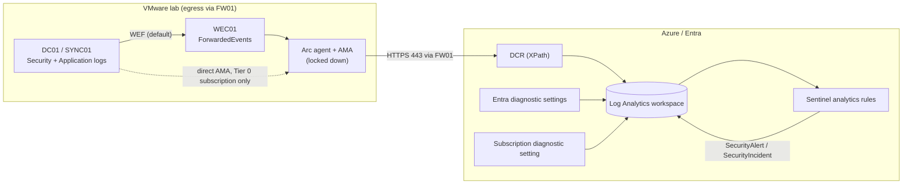
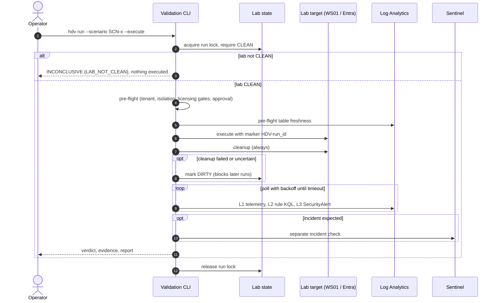

# Data Flow

> **Status:** Phase 0 design (revision 2). Nothing is collected yet. Latency and volume figures
> are planning assumptions to be replaced by values measured in Phase 2/4.

## 1. Telemetry sources and destinations

Licensing values come from [`tools/data/licensing-matrix.yml`](../tools/data/licensing-matrix.yml),
which records the sources. "Gate" means the export requirement is unresolved and must be tested
empirically ([cost-and-licensing.md §4](cost-and-licensing.md#4-empirical-licensing-gates)).

| # | Source | Path | Table(s) | Licence for export | Notes |
|---|---|---|---|---|---|
| F1 | DC01 / SYNC01 Security log (**default**) | WEF → WEC01 → Arc + AMA (Windows Forwarded Events) | `WindowsEvent` | none | [ADR-0011](adr/0011-tier0-arc-isolation-wef-fallback.md) default; shape differs from `SecurityEvent` |
| F1′ | DC01 / SYNC01 Security log (only with a dedicated Tier 0 subscription) | Arc (locked down) → AMA → DCR | `SecurityEvent` | none | Requires all ADR-0011 conditions |
| F2 | SYNC01 Application log (ADSync events) | WEF or AMA as above | `WindowsEvent` / `Event` | none | Sync errors and configuration changes |
| F3 | WS01 (optional) | WEF to WEC01 (recommended), or Arc if WS01 is always on | `WindowsEvent` / `SecurityEvent` | none | Arc supports Windows client OS only in server-like, always-connected use |
| F4 | Arc agents | Built-in | `Heartbeat` | none (free) | Pre-flight freshness |
| F5 | Entra ID audit | Entra diagnostic settings | `AuditLogs` | **Gate LIC-001** | Portal: available on Free (7 days) |
| F6 | Entra interactive sign-ins | Entra diagnostic settings | `SigninLogs` | **P1/P2** (documented) | Portal: available on Free (7 days) |
| F7 | Entra non-interactive / service principal / managed identity sign-ins | Entra diagnostic settings | `AADNonInteractiveUserSignInLogs`, `AADServicePrincipalSignInLogs`, `AADManagedIdentitySignInLogs` | **Gates LIC-002 / LIC-003 / LIC-004** | `AADServicePrincipalSignInLogs` carries the Entra Connect application sign-ins |
| F8 | Identity Protection | Entra diagnostic settings | `AADRiskyUsers`, `AADUserRiskEvents` | P1 (limited) / P2 (full) | Post-MVP |
| F9 | Azure control plane | Subscription diagnostic setting | `AzureActivity` | none (free) | Arc, DCR and diagnostic-setting tampering |
| F10 | Sentinel output | Analytics rules | `SecurityAlert`, `SecurityIncident` | — | Verdict layer L3 and the separate incident check |

## 2. Validation run sequence (planned, Phase 4)

## 3. Windows audit prerequisites

Default Windows auditing does **not** produce all events below. Missing settings cause
INCONCLUSIVE (L1) results, not FAILs. Settings are applied in Phase 2 through a **new dedicated
GPO**. Existing GPOs and SACLs are read first and never overwritten.

| Event ID | Description | Advanced Audit Policy subcategory | Extra requirement | Candidate use |
|---|---|---|---|---|
| 4662 | Operation performed on an AD object | DS Access → Directory Service Access | **SACL** on the domain root ([DCSync design](dcsync-detection-design.md)) | DCSync |
| 4624 (LogonType 3) | Network logon | Logon/Logoff → Logon | — | **Source attribution for DCSync** (join on Computer + LogonId) |
| 5136 | Directory object modified | DS Access → Directory Service Changes | SACL on monitored objects | ACL / object changes |
| 4720 / 4722 / 4738 | User created / enabled / changed | Account Management → User Account Management | — | Persistence |
| 4728 / 4732 / 4756 | Member added to security group | Account Management → Security Group Management | — | Privileged groups |
| 4768 / 4769 / 4771 / 4776 | Kerberos TGT / service ticket / pre-auth failure / NTLM | Account Logon subcategories | — | Kerberoasting, spraying |
| 4688 | Process created | Detailed Tracking → Process Creation | Command line in process creation events | Run-marker correlation (WS01) |
| 4719 / 1102 | Audit policy changed / log cleared | Policy Change / System | — | Defense evasion |

Plus the security option *"Audit: Force audit policy subcategory settings … to override audit
policy category settings"*. Collect with explicit XPath filters and test each filter locally with
`Get-WinEvent -FilterXPath` first. The 4662/4624 filters are specified in
[dcsync-detection-design.md §3](dcsync-detection-design.md#3-collection-filters-dcr-xpath-and-their-volume-impact).

## 4. Latency budget (assumptions to be measured)

| Segment | Planning assumption | Measured by |
|---|---|---|
| Event → workspace (direct AMA) | minutes | L1 `ingestion_time() - TimeGenerated` |
| Event → WEC01 → workspace (WEF) | minutes, plus the WEF delivery interval | L1 (timestamp setting `UseTimeReceivedForForwardedEvents` affects this) |
| Entra logs → workspace | minutes to tens of minutes | L1 |
| Scheduled rule pickup | up to `query_frequency` (≥ 5 min) | L3 alert time − event time |
| Alert → `SecurityAlert` visible | minutes | L3 |

Default `validation.timeout` is 30–45 minutes until real measurements exist (allowed range PT5M–P1D).

## 5. CI data flow

| Trigger | Job | Cloud access | Reads | Writes | Status |
|---|---|---|---|---|---|
| Pull request, push to `main`, manual | `content` | **none** | Repository | Job logs | Implemented |
| Pull request, push to `main`, manual | `secrets` (gitleaks) | **none** | Repository + history | Job logs (redacted) | Implemented |
| Pull request (Phase 3) | KQL parse | none | Repository | Job logs | Planned |
| Manual / schedule (Phase 5) | Evaluate | OIDC → workspace-scoped Reader roles | Workspace tables | Sanitised report artefact | Planned |
| Manual, approved (Phase 3/5) | Deploy rules | OIDC → workspace-scoped Sentinel Contributor | YAML | Analytics rules | Planned |

## 6. Data classification and handling

| Data | Where | Sensitivity | Handling |
|---|---|---|---|
| Lab hostnames, IPs, tenant ID, UPNs | Local inventory, workspace, SQLite | Internal | Never committed (`.gitignore`); redacted in published reports |
| Lab state and run lock | `.hdv/` (local) | Internal | Git-ignored |
| Secrets for scenario identities | Local secret store / environment | Secret | Never in repo, logs, SQLite or reports; sensitive inputs cannot have defaults (schema) |
| Certificates and private keys (Entra Connect application, scenario identities) | Windows certificate stores; TPM where available | Secret | Never exported to files in the repo; `.gitignore` covers `*.pfx`, `*.p12`, `*.pem`, `*.key`, `*.cer`, `*.crt`; gitleaks rules for key blocks |
| Entra Connect configuration exports | Protected location outside Git | Internal | `.gitignore` blocks `Applied-SynchronizationPolicy-*.json` and `Exported-ServerConfiguration-*` |
| FW01 configuration export | Protected location outside Git | Internal | Never committed |
| Detection / scenario content | Git | Public-safe | Reviewed in PRs; validated as untrusted input |
| Verdict history | SQLite | Internal | Local; exported reports sanitised |
