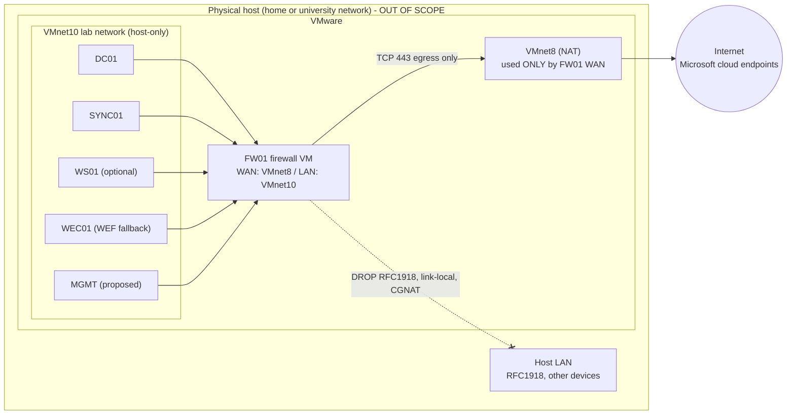

# Lab Network Isolation Design

> **Status:** design (Phase 0). Nothing has been configured in the lab. Governing decision:
> [ADR-0012](adr/0012-lab-network-isolation.md). Readiness checks are implemented as
> read-only scripts in [`lab/powershell/isolation/`](../lab/powershell/isolation/) and have
> been tested only against synthetic inputs.

## 1. Why NAT alone is not isolation

With VMware NAT, a guest can reach any address the host can reach, including the host's own
LAN (home router, university network, printers, other students' machines). Adversary-emulation
activity (Kerberos ticket requests, password-spray style sign-ins, Atomic tests) must never
leave the lab segment except as HTTPS to the Microsoft cloud endpoints the lab needs.

## 2. Topology

- **FW01** is a dedicated firewall VM (an open-source firewall distribution such as OPNsense or
  pfSense; the choice is not mandated) with exactly two NICs: WAN on VMnet8 (NAT) and LAN on
  the lab network.
- **VMnet10** (name is an example) is a *custom host-only* network with
  "Connect a host virtual adapter to this network" **unchecked** and VMware DHCP **disabled**.
  The host therefore has no interface on the lab network.
- **Bridged networking is never used** by any lab VM, including FW01.
- On ESXi the equivalent is a port group on a vSwitch **without uplinks** for the lab, and a
  separate port group for FW01's WAN.

## 3. FW01 rule set (LAN interface, evaluated top-down)

| # | Action | Source | Destination | Port | Purpose |
|---|---|---|---|---|---|
| 1 | Allow | MGMT | FW01 LAN address | 443 | Firewall administration from the lab only |
| 2 | Allow | DC01 | FW01 LAN address, or named public resolvers | 53 | DNS forwarding for the lab domain |
| 3 | Allow | DC01 | Named NTP servers | UDP 123 | Time source for the domain (Kerberos depends on it) |
| 4 | **Block (drop, log)** | Lab network | 10.0.0.0/8, 172.16.0.0/12, 192.168.0.0/16, 100.64.0.0/10, 169.254.0.0/16 | any | Host LAN and every other private network, including the VMware NAT gateway |
| 5 | Allow | Lab network | any | TCP 443 | HTTPS egress: Arc, AMA, Entra Connect, Microsoft Graph, Windows Update |
| 6 | **Block (log)** | any | any | any | Default deny |

- Use **block (silent drop)** for rule 4, not reject. The guest check treats only a timeout as
  "blocked", so a refused connection unambiguously means that a path exists.
- **WAN interface:** no inbound rules, no port forwards. The WAN gateway is the VMware NAT
  gateway (itself RFC1918), so do not enable a generic "block private networks on WAN" option
  that would break FW01's own egress. Rule 4 on the LAN side is what protects the host LAN.
- **Optional strict mode:** replace rule 5 with an FQDN allow-list of the Microsoft endpoints
  the lab uses. This is harder to maintain (wildcard endpoints) and is not required for the MVP.

## 4. Isolation readiness checks (gate G-NET)

All checks must PASS before any scenario runs, and again after any change to VMware networking
or FW01. Results are recorded in the lab-state attestation ([ADR-0013](adr/0013-lab-state-cleanup-sweeper.md)).

| ID | Check | Where | How | Automated |
|---|---|---|---|---|
| I1 | No bridged NIC; every lab NIC on the lab network; FW01 has one LAN and at most one WAN NIC | Host | [`Test-HdvVmxNetworking.ps1`](../lab/powershell/isolation/Test-HdvVmxNetworking.ps1) parses `.vmx` files read-only | Yes |
| I2 | Host has no virtual adapter on the lab network | Host | Same script with `-CheckHostAdapter` (Windows host); otherwise manual check in the Virtual Network Editor | Partly |
| I3 | Default route = FW01; DNS lab-internal; host LAN and other RFC1918 targets time out; Microsoft endpoints reachable on 443 | Every lab VM | [`Test-HdvLabIsolation.ps1`](../lab/powershell/isolation/Test-HdvLabIsolation.ps1), read-only | Yes |
| I4 | FW01 configuration reviewed: rule order as in §3, no port forwards, logging on rules 4 and 6 | FW01 | Export the configuration and review it; keep the export outside Git (it contains addresses) | Manual |
| I5 | Negative evidence: FW01 log shows dropped attempts from I3 | FW01 | Inspect firewall log after running I3 | Manual |

Both scripts fail closed: a check that cannot run is reported as FAIL (or MANUAL for I2), never as PASS.
