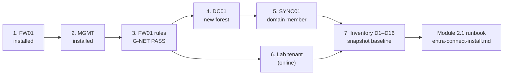

# Runbook: build the HDV lab from scratch

> Operator runbook for an owner who has **no lab yet**. **Not executed yet.** Every step is
> performed by the owner (🖥️); nothing here is automated, and no HDV script installs anything.
> The target design is [lab-network.md](../lab-network.md) and [lab-requirements.md](../lab-requirements.md).
> Product facts marked **(verify)** change often: confirm them on the vendor page you download from.
> Wizard and menu labels may differ slightly between releases.

## 0. What you build, and in which order

| Stage | VM / item | Role | OS | vCPU / RAM | Needed for |
|---|---|---|---|---|---|
| 1 | **FW01** | The lab's only exit to the internet | Open-source firewall (OPNsense used as the example; pfSense also fits) | 1–2 / 1–2 GB | Everything |
| 2 | **MGMT** | Admin workstation inside the lab; also acts as WS01 for now | Windows 11 Enterprise (evaluation) | 2 / 4 GB | Everything |
| 3 | FW01 rules + gate **G-NET** | Isolation proven before anything else | — | — | Everything after |
| 4 | **DC01** | Domain controller + DNS, new single-domain forest | Windows Server 2025 (evaluation), Desktop Experience | 2 / 4 GB | Module 2.1 |
| 5 | **SYNC01** | Member server for Entra Connect (Tier 0) | Windows Server 2025 (evaluation), **Desktop Experience** | 2 / 6–8 GB (Microsoft minimum 6 GB, 70 GB disk) | Module 2.1 |
| 6 | **Lab tenant** | Dedicated Microsoft Entra tenant | Cloud | — | Module 2.1 |
| 7 | Inventory + gates | D1–D16, snapshots, readiness | — | — | Module 2.1 |

**Later, not now:** WEC01 (event collection, Module 2.2+), a separate WS01, and every Azure
resource (Phase 1, `terraform plan` first, apply only after approval).



Take a **snapshot at the end of every stage** (names in §10). Never continue from a stage whose
checks failed.

## 1. Before you start: host check and decisions

### 1.1 Host capacity (read-only checks on your computer)

| Item | Requirement | Why |
|---|---|---|
| CPU virtualization | VT-x / AMD-V enabled in the firmware (BIOS/UEFI) | VMware cannot run 64-bit guests without it |
| RAM | **32 GB recommended.** Stages 1–5 need about 15–18 GB for the guests plus the host OS. **16 GB is the minimum**: use the profile in §1.2 | Estimate from the sizing table above |
| Disk | SSD, **≥ 300 GB free** recommended (thin-provisioned disks + snapshots) | Windows 11 requires ≥ 64 GB per VM; snapshots grow over time |
| Host network | Note the host LAN range (for example with `ipconfig` on Windows) | The lab range must **not** overlap it (§1.3) |

### 1.2 16 GB host profile (minimum; Module 2.1 only)

On a 16 GB host, about 12 GB can go to the guests. Close every other application on the host while the lab runs.

| VM | RAM | Change from the default sizing |
|---|---|---|
| FW01 | 1 GB | — |
| DC01 | 2 GB | **Server Core** (no Desktop Experience). Administered from MGMT with RSAT; static address set with `sconfig` → *Network settings* |
| SYNC01 | 6 GB | None: Microsoft's minimum for Entra Connect Sync. Desktop Experience stays mandatory |
| MGMT | 4 GB to install, then 3 GB | Windows 11 requires 4 GB; 3 GB afterwards is below Microsoft's requirement and unsupported, but enough for administration |

Total about 12 GB. **WEC01 (Module 2.2) does not fit** next to these: upgrade the host to 32 GB before Module 2.2, or run WEC01 only while MGMT is shut down. Check the installed modules and free slots first (read-only):

```powershell
Get-CimInstance Win32_PhysicalMemory | Select-Object Capacity, Speed, PartNumber
```

```powershell
Get-CimInstance Win32_PhysicalMemoryArray | Select-Object MemoryDevices, MaxCapacity
```

### 1.3 Decisions to record (local inventory, outside Git)

Create `lab.local.yml` at the repository root on your computer. It is **git-ignored**; never
commit or share it. Fill it in as you go (skeleton in §11).

| # | Decision | Rules |
|---|---|---|
| B1 | **Lab IP range** (`LAB_CIDR`) | A private range that does **not** overlap your host LAN, the VMware NAT network (VMnet8) or any VPN you use. Pick it yourself; nothing in this project assumes one |
| B2 | FW01, DC01, SYNC01, MGMT **addresses** | Inside `LAB_CIDR`. Static for FW01, DC01, SYNC01; MGMT static or a DHCP reservation (rule 1 needs a fixed address) |
| B3 | **AD DNS domain name** and NetBIOS name | Not a single label, **not `.local`**. Microsoft's guidance is a subdomain of a domain you own. A non-routable name also works: users then sync as `@<tenant>.onmicrosoft.com` (discovery item D4). NetBIOS name ≤ 15 characters |
| B4 | **Lab tenant source** | See §8. Never a university or employer tenant |
| B5 | **Passwords** | Store every password in a password manager: FW01 root, local admins, DSRM, domain admin, VM encryption passwords, cloud admin. Never in Git, never in `lab.local.yml` |

## 2. Downloads (official sources only)

| What | Where | Notes |
|---|---|---|
| VMware Workstation Pro | Broadcom support portal | Free for personal use; a Broadcom account is required to download **(verify the current licence terms)** |
| Windows Server 2025 evaluation ISO | Microsoft Evaluation Center | 180-day evaluation. The page states the evaluation must be **activated online within the first 10 days** or it shuts down periodically **(verify)**: build FW01 first so the VMs have internet |
| Windows 11 Enterprise evaluation ISO | Microsoft Evaluation Center | 90-day evaluation; test environments only |
| OPNsense ISO | opnsense.org | Verify the published SHA-256 checksum before use |

Write each download date in `lab.local.yml`: evaluation periods start at installation, and you
must plan rebuilds before they expire (§10).

## 3. Stage 0: VMware networks

🖥️ VMware Workstation → **Edit → Virtual Network Editor** (administrator):

1. **Add Network** → choose an unused custom network, for example `VMnet10` (the name is an example).
2. Type: **Host-only**.
3. **Uncheck** "Connect a host virtual adapter to this network".
4. **Uncheck** "Use local DHCP service to distribute IP address to VMs".
5. Subnet IP / mask: your `LAB_CIDR` (B1).
6. Leave `VMnet8` (NAT) as it is: it will be used **only** by FW01's WAN interface.

**Never** use bridged networking for any lab VM, including FW01 ([lab-network.md §2](../lab-network.md#2-topology)).
On a Linux host the editor is `vmware-netcfg`; the settings are the same.

## 4. Stage 1: FW01

🖥️ Create the VM:
- guest OS: FreeBSD 64-bit (OPNsense is FreeBSD-based); 1–2 vCPU, 1–2 GB RAM, about 20 GB disk;
- **network adapter 1: NAT (VMnet8)** → will be WAN;
- **network adapter 2: Custom → VMnet10** → will be LAN;
- remove the USB controller, sound card and printer.

🖥️ Install OPNsense from the ISO, then on the FW01 console:
1. **Assign interfaces**: WAN = the NIC on NAT, LAN = the NIC on VMnet10. Compare the MAC addresses with
   VM Settings → Network Adapter → Advanced so they are not swapped.
2. **Set interface IP address** for LAN: `FW01_LAN_IP` with your prefix length. WAN stays on DHCP from VMware NAT.
3. Enable the **DHCP server on LAN** with a small range inside `LAB_CIDR` (temporary, for MGMT's
   first boot; reservations come in stage 3).
4. Change the default root password (B5).

⚠️ Until stage 3, OPNsense's default LAN rule allows everything, so **the lab is not isolated yet**.
Do nothing in the lab except install MGMT and configure FW01.

✅ Snapshot `S1-fw01-installed`.

## 5. Stage 2: MGMT

🖥️ Create the VM: Windows 11 x64, **UEFI firmware**, 2 vCPU, 4 GB RAM, ≥ 64 GB disk,
**one network adapter: Custom → VMnet10**.

Windows 11 requires a TPM. In VMware Workstation a virtual TPM can only be added to an
**encrypted** VM: VM Settings → **Options → Access Control → Encrypt** (choose a password and store it, B5), then
**Hardware → Add → Trusted Platform Module**. The password is asked at every power-on;
losing it loses the VM.

🖥️ Install Windows 11 Enterprise (evaluation). Create a **local** administrator account
(during setup, choose the offline or domain-join option; the wording varies by release). MGMT gets
an address from FW01's DHCP.

🖥️ From MGMT, open `https://<FW01_LAN_IP>` and finish the OPNsense setup wizard.

✅ Snapshot `S2-mgmt-installed`.

## 6. Stage 3: FW01 rules and gate G-NET

### 6.1 Addresses and aliases

1. Give MGMT a fixed address (a DHCP **static mapping** on FW01, or a static IP) = `MGMT_IP`.
2. On FW01, create **aliases**: `MGMT` (MGMT_IP), `DC01` (DC01_IP, not built yet), `PRIVATE_NETS`
   (`10.0.0.0/8`, `172.16.0.0/12`, `192.168.0.0/16`, `100.64.0.0/10`, `169.254.0.0/16`),
   `NTP_SERVERS` (the NTP host names you choose for DC01).

### 6.2 LAN rules (top-down), exactly as [lab-network.md §3](../lab-network.md#3-fw01-rule-set-lan-interface-evaluated-top-down)

| # | Action | Source | Destination | Port | Note |
|---|---|---|---|---|---|
| 1 | Allow | MGMT | FW01 LAN address | TCP 443 | Firewall administration |
| **T1** | Allow | Lab network | FW01 LAN address | 53 | **Temporary bootstrap rule**: DNS for MGMT until DC01 exists. **Removed in §7.4** |
| 2 | Allow | DC01 | FW01 LAN address | 53 | DNS forwarding for the lab domain (used from stage 4) |
| 3 | Allow | DC01 | NTP_SERVERS | UDP 123 | Domain time source |
| 4 | **Block, log** | Lab network | PRIVATE_NETS | any | Silent drop (**not** reject) |
| 5 | Allow | Lab network | any | TCP 80, 443 | Internet egress (HTTP is required for certificate revocation lists) |
| 6 | **Block, log** | any | any | any | Default deny |

Then:
- **disable or delete the default "allow LAN to any" rules** (IPv4 and IPv6);
- once rule 1 works from MGMT, **disable the anti-lockout rule** so that only MGMT reaches the web UI
  (System → Settings → Administration in current OPNsense releases **(verify)**);
- WAN: no inbound rules, no port forwards. Do **not** enable "Block private networks" on WAN (the WAN
  gateway is the VMware NAT gateway, itself private).

### 6.3 Gate G-NET (all must PASS before stage 4)

Get the repository's scripts onto MGMT from GitHub over HTTPS (Download ZIP, or `git clone` if you
choose to install Git there) and onto the host the same way. All checks are read-only.

| Check | Where | Command |
|---|---|---|
| I1, I2 | Host | `.\lab\powershell\isolation\Test-HdvVmxNetworking.ps1 -Path <folder of the lab VMs> -LabNetworks VMnet10 -FirewallVmx <path of FW01.vmx> -SharedFoldersAllowedVmx <path of MGMT.vmx> -CheckHostAdapter` |
| I3 | MGMT | `.\lab\powershell\isolation\Test-HdvLabIsolation.ps1 -ExpectedGateway <FW01_LAN_IP> -ForbiddenTargets <host LAN gateway>,<host IP> -IncludeCommonPrivateGateways -ExcludeTargets <FW01_LAN_IP>` |
| I4 | FW01 | Export the configuration, keep it **outside Git**, review the rule order against §6.2 |
| I5 | FW01 | Firewall log shows the drops caused by I3 |

Also confirm Windows activation on MGMT: `slmgr /dlv` (shows the remaining evaluation time).

✅ Snapshot `S3-gnet-pass` (FW01 + MGMT).

## 7. Stage 4: DC01 (new single-domain forest)

### 7.1 Install

🖥️ Create the VM: Windows Server 2025, UEFI, 2 vCPU, 4 GB RAM, one NIC on **VMnet10**. Install
**Windows Server 2025 Standard Evaluation (Desktop Experience)**, or the edition without
Desktop Experience (Server Core, 2 GB RAM) on a 16 GB host (§1.2).

🖥️ In an elevated PowerShell on DC01:

```powershell
Rename-Computer -NewName "DC01" -Restart
```

After the restart, set the static address (B2) in the network adapter settings: IP `DC01_IP`,
gateway `FW01_LAN_IP`, DNS **`FW01_LAN_IP` for now**. Check activation with `slmgr /dlv`.

### 7.2 Promote (creates the forest)

```powershell
Install-WindowsFeature AD-Domain-Services -IncludeManagementTools
```

```powershell
Install-ADDSForest -DomainName "<B3 DNS name>" -DomainNetbiosName "<B3 NetBIOS name>" -InstallDns -SafeModeAdministratorPassword (Read-Host -AsSecureString "DSRM password")
```

The server restarts. **Never add a child domain or a second domain**: HDV requires a strict
single-domain forest, and `Set-HdvConnectorAccountPermissions.ps1` refuses anything else.

### 7.3 DNS and time

```powershell
Set-DnsClientServerAddress -InterfaceAlias "<adapter name>" -ServerAddresses "<DC01_IP>"
```

```powershell
Add-DnsServerForwarder -IPAddress "<FW01_LAN_IP>"
```

```powershell
w32tm /config /manualpeerlist:"<NTP host names, space-separated>" /syncfromflags:manual /reliable:yes /update
```

Verify with `w32tm /query /status` and `Resolve-DnsName login.microsoftonline.com`.

### 7.4 Close the bootstrap

1. FW01: DHCP now hands out **`DC01_IP` as DNS server** (or switch the lab to static addresses).
2. FW01: **delete rule T1**. From here on only DC01 talks to FW01 on port 53 (rule 2).
3. Re-run **I3 on MGMT** with `-AllowedDnsServers <DC01_IP>` after MGMT has renewed its address.

### 7.5 Daily-use admin account

Create a dedicated lab admin account and add it to **Domain Admins**. Use it instead of the built-in
Administrator. Keep its password in your password manager.

✅ Snapshot `S4-dc01-forest` (FW01 + MGMT + DC01).

## 8. Stage 5: join MGMT, build SYNC01

### 8.1 MGMT joins the domain

```powershell
Add-Computer -DomainName "<B3 DNS name>" -Credential (Get-Credential) -Restart
```

Install the AD management tools on MGMT (they download through FW01):

```powershell
Add-WindowsCapability -Online -Name "Rsat.ActiveDirectory.DS-LDS.Tools~~~~0.0.1.0"
```

### 8.2 SYNC01

🖥️ Create the VM: Windows Server 2025, UEFI, 2 vCPU, 6–8 GB RAM (Microsoft minimum 6 GB), ≥ 70 GB disk, one NIC on **VMnet10**.
**Desktop Experience is mandatory**: Microsoft does not support Entra Connect on Server Core.
Recommended: encryption + virtual TPM, as for MGMT (§5): Entra Connect can protect its
certificate with the TPM (discovery item D16).

🖥️ Install, rename to `SYNC01`, set the static address (gateway `FW01_LAN_IP`, DNS `DC01_IP`), join the domain
(`Add-Computer`, as above). **Do not install Entra Connect yet.**

✅ Snapshot `S5-sync01-joined`.

## 9. Stage 6: dedicated lab tenant (online, from your computer)

| Your situation | How to get a dedicated tenant |
|---|---|
| You have no paid Microsoft cloud account | Sign up for an **Azure free account** with a **new personal Microsoft account created only for the lab**. Microsoft points to this route because free and trial tenants cannot create additional tenants **(verify the current sign-up requirements on the page)** |
| You already administer a **paid** tenant | Microsoft Entra admin center or Azure portal → Entra ID → **Manage tenants → Create → Microsoft Entra ID** |
| Your only account is from a university or employer | **Stop.** Never use that tenant, even with admin rights |

Then, in the new tenant:
1. Entra admin center → **Overview**: note the **Tenant ID** and the **initial domain**
   (`<name>.onmicrosoft.com`). Check that you are **Global Administrator** and that no other users exist.
2. Create a **cloud-only** admin account `<name>@<initial domain>` and register **MFA** for it.
   Entra Connect setup uses this account (Hybrid Identity Administrator; see the Module 2.1 runbook).
3. Record the licence state shown in the admin center (probably **Free**). Entra Connect Sync
   itself is free; Connect Health requires P1.
4. **Do not create any Azure resources.** That is Phase 1 (Terraform plan first, apply only after approval).

## 10. Stage 7: inventory, snapshots, readiness

1. Fill in the discovery items **D1–D16** ([lab-requirements.md §2](../lab-requirements.md#2-discovery-checklist-owner-fills-in-read-only-commands))
   with the read-only commands listed there.
2. Walk through the readiness gates ([lab-requirements.md §5](../lab-requirements.md#5-readiness-gates-before-phase-2-changes-anything)).
   WEC01 and the Tier 0 decision (G-T0) can wait: Module 2.1 does not need them.
3. Shut down all VMs and take one consistent snapshot set `S7-baseline-clean`.
4. Continue with [entra-connect-install.md](entra-connect-install.md).

| Snapshot | Taken after | VMs |
|---|---|---|
| `S1-fw01-installed` | §4 | FW01 |
| `S2-mgmt-installed` | §5 | FW01, MGMT |
| `S3-gnet-pass` | §6 | FW01, MGMT |
| `S4-dc01-forest` | §7 | FW01, MGMT, DC01 |
| `S5-sync01-joined` | §8 | all |
| `S7-baseline-clean` | §10 | all, powered off |

**Evaluation clocks:** Windows 11 Enterprise runs out after 90 days and Windows Server after 180 days.
Reverting a snapshot does not give you a fresh evaluation period. Record the expiry dates
(`slmgr /dlv`) and plan a rebuild before they pass.

## 11. `lab.local.yml` skeleton (fill in locally; git-ignored; no passwords)

```yaml
# Local lab inventory. NEVER commit. No passwords or secrets in this file.
host:
  lan_range: "<host LAN CIDR>"
  ram_gb: <n>
lab_network:
  vmware_network: "VMnet10"
  cidr: "<LAB_CIDR>"
vms:
  FW01:   { lan_ip: "<FW01_LAN_IP>", vmx: "<path>" }
  MGMT:   { ip: "<MGMT_IP>", vmx: "<path>", os_installed: "<date>", eval_expiry: "<date>" }
  DC01:   { ip: "<DC01_IP>", vmx: "<path>", os_installed: "<date>", eval_expiry: "<date>" }
  SYNC01: { ip: "<SYNC01_IP>", vmx: "<path>", os_installed: "<date>", eval_expiry: "<date>" }
ad:
  dns_root: "<B3 DNS name>"
  netbios: "<B3 NetBIOS name>"
tenant:
  tenant_id: "<GUID>"
  initial_domain: "<name>.onmicrosoft.com"
  licence: "<Free | P1 | P2 | trial>"
discovery: {}   # D1-D16 results
```

## 12. Troubleshooting

| Symptom | Check | Never do |
|---|---|---|
| A VM has no internet | FW01 log: which rule dropped it? Gateway = `FW01_LAN_IP`? DNS = DC01 (or FW01 before §7.4)? | Switch the VM to NAT or bridged "temporarily" |
| Windows does not activate | Internet through FW01 (443 and 80), DNS resolution, `slmgr /dlv` | Use unofficial activation tools |
| Cannot reach the FW01 web UI | Are you on MGMT, with `MGMT_IP`? Is rule 1 enabled? If you locked yourself out, fix the rules from the FW01 console | Expose the web UI on WAN |
| Domain join fails | MGMT/SYNC01 DNS must be `DC01_IP`; time difference < 5 minutes (`w32tm /query /status`) | Point clients to a public DNS server |
| I3 reports a forbidden target as reachable | Rule 4 order and action (block, not reject); default allow rules removed | Mark the check as passed anyway |
