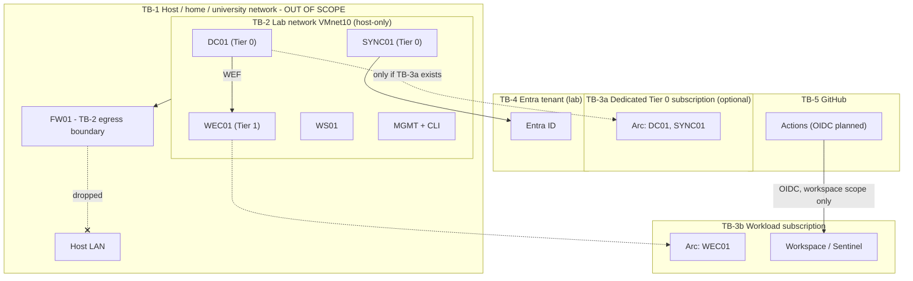

# Threat Model

> **Status:** Phase 0 baseline, revision 2 (after the Phase 0 review). Revisit at the end of
> every phase and whenever a trust boundary changes.

- **Part A:** threats *to* the platform (STRIDE).
- **Part B:** threats *detected by* the platform (MITRE ATT&CK, pinned to Enterprise 20.1).

---

## Part A: Threats to the platform

### A.1 Assets

| ID | Asset | Why it matters |
|---|---|---|
| AS-1 | DC01 / AD DS forest | Tier 0. Full control of on-premises identity |
| AS-2 | SYNC01 / Entra Connect Sync | **Tier 0** (Microsoft guidance). Can read password hashes (PHS) and write identities to Entra ID; holds the Connect application certificate |
| AS-3 | Entra tenant (lab) | Cloud identity plane |
| AS-4 | Azure subscriptions (workload; Tier 0 if created) | Arc resources control the machines they represent |
| AS-5 | Workspace / Sentinel | Integrity of the evidence |
| AS-6 | CI identities (OIDC, planned) | Bridge from GitHub into Azure |
| AS-7 | Scenario identities | Deliberately privileged to emulate attacks |
| AS-8 | Repository, SQLite results, reports, lab state | Content integrity; may contain tenant details |
| AS-9 | The owner's home / university network | Must never be affected by the lab |
| AS-10 | WEC01 (WEF collector) | Receives Tier 0 security logs; can read or drop them |
| AS-11 | FW01 | The isolation boundary |

### A.2 Trust boundaries

**Key observation:** an Azure scope that holds an Arc resource for a Tier 0 machine is itself
inside Tier 0. Microsoft: *"treat any subscription or management group admin as equivalent to a
local administrator on Tier 0 assets."* This is why DC01/SYNC01 are Arc-connected only inside a
dedicated Tier 0 subscription, and use WEF otherwise ([ADR-0011](adr/0011-tier0-arc-isolation-wef-fallback.md)).

### A.3 STRIDE analysis

| ID | Threat | STRIDE | Asset | L | I | Mitigation | Status |
|---|---|---|---|---|---|---|---|
| TM-01 | Azure principal with rights on an Arc machine (or its subscription/MG) deploys an extension or Run Command on DC01 → SYSTEM on the DC | E | AS-1, AS-4 | M | Critical | Default: DC01/SYNC01 **not** Arc-connected (WEF). With a Tier 0 subscription: dedicated subscription, minimal admins, local lockdown (incoming connections off, machine configuration off, allowlist = AMA only) applied **before** connect; the allowlist cannot be overridden from Azure | Lockdown script implemented (untested on a real agent) |
| TM-02 | Azure Policy (DeployIfNotExists / Modify) pushes extensions or configuration to Arc machines | E/T | AS-1 | L | Critical | No such assignments on the Tier 0 subscription or inherited management groups; machine configuration disabled locally | Planned |
| TM-03 | SYNC01 compromised → connector account replication rights → DCSync, or tampering with sync | E/I | AS-2 | M | Critical | Tier 0 hardening; OU-scoped sync; disable hard-match takeover; downgrade the Hybrid Identity Administrator role after setup; DCSync detection with source attribution | Planned |
| TM-04 | Entra Connect **application identity** abused from outside SYNC01 | S/E | AS-3 | L | High | App-based auth with certificate (TPM recommended); detection on service principal sign-ins from non-lab IPs (gate LIC-003); detection on credentials added to the Connect application | Planned |
| TM-05 | OIDC federated credential too broad → attacker obtains an Azure token | S/E | AS-6 | M | High | Environment-bound subject; job-level `id-token`; no OIDC on `pull_request`; workspace-scoped Reader roles; never any role in Tier 0 scope | Policy enforced by `tests/test_workflows.py`; OIDC itself planned |
| TM-06 | Secrets leaked via repository, logs, SQLite or YAML defaults | I/E | AS-7, AS-3 | M | High | Schema forbids defaults on sensitive inputs; gitleaks in CI (default + project rules); `.gitignore` for keys, certificates, state, results; sensitive inputs never logged | Implemented (schema, CI); runner rules planned |
| TM-07 | Scenario executed against a non-lab tenant or domain | T/D | AS-9, third parties | M | High | Fail-closed pre-flight on tenant ID and domain; schema allows only `lab`; dry-run by default | Schema implemented; pre-flight planned |
| TM-08 | Brute-force scenario causes lockouts or violates provider rules | D | AS-3 | L | M | Mandatory `rate_limit` for T1110 (validator); lab accounts only; Microsoft Cloud Penetration Testing Rules of Engagement | Implemented (validator) |
| TM-09 | Supply-chain compromise (Actions, Python packages, Atomic Red Team, gitleaks, ATT&CK data) | T/E | AS-1, AS-8 | L | High | Actions pinned by SHA; hash-locked Python deps; gitleaks installed with Go checksum-database verification; ART pinned by commit (schema); ATT&CK data generated from a pinned commit; Dependabot | Implemented |
| TM-10 | False PASS from an unrelated alert | T | AS-5, AS-8 | M | M | Run-marker / entity correlation; `time_window_only` needs a justification; evidence stored | Schema implemented; engine planned |
| TM-11 | Telemetry silently stops (agent, DCR, WEF subscription, cap) | D | AS-5 | H | M | L1 + pre-flight freshness; INCONCLUSIVE with reason codes; detections on DCR / diagnostic-setting changes | Planned |
| TM-12 | Reports published with tenant IDs, UPNs, IPs | I | AS-8 | M | L | Results, reports and state git-ignored; redaction | Partly implemented (.gitignore) |
| TM-13 | Lab traffic reaches the host LAN (NAT is not isolation) | E/I/D | AS-9 | M | High | Host-only network, no host adapter, FW01 drops RFC1918; isolation checks I1–I5 as a gate | Checks implemented (synthetic tests only) |
| TM-14 | Cost exhaustion | D | AS-4 | M | M | Budget alerts, daily cap, XPath filters (recalculated) | Planned |
| TM-15 | Repudiation: unknown who ran what | R | AS-8 | L | L | Run records with operator, commit SHA, scenario version; lab-state history | Lab-state history implemented |
| TM-16 | Antivirus disabled for a test and left disabled | T | AS-1 | M | M | Never on DC01/SYNC01; WS01 path-scoped exclusions removed in cleanup and verified by the sweep | Planned |
| TM-17 | Theft of the Entra Connect application certificate (software key storage without TPM) | S/E | AS-2, AS-3 | L | High | vTPM recommended; certificate never exported; detection TM-04; 90-day automatic rotation | Planned |
| TM-18 | WEC01 compromise: reads or suppresses forwarded Tier 0 events | I/D | AS-10 | L | High | Hardened Tier 1 server; lockdown; forwarding-gap detection via L1 freshness per source computer | Planned |
| TM-19 | Snapshot restore desynchronises AD, Entra Connect, Arc or cloud state | T | AS-1, AS-2, AS-3 | M | M | Restore procedures in [safety.md](safety.md#4-snapshot-restoration-risks); lab DIRTY until a cloud sweep is verified | Documented; sweeper implemented |
| TM-20 | Sweeper deletes non-lab objects | T/D | AS-3 | L | High | Selectors limited to `HDV-` prefix / tagged lab objects; dry-run default; unrelated objects must survive (tested) | Implemented (core, with fakes) |
| TM-21 | Malicious content file attacks the tooling (YAML bombs, unsafe tags, path traversal, command injection, symlinks) | T/E/D | AS-8 | M | M | Hardened loader, schema patterns, validator checks, malicious-fixture tests | Implemented |
| TM-22 | Lab state file tampered with to bypass the DIRTY block | T | AS-8 | L | M | Corrupt or unknown state fails closed; local-only file; history kept. A local administrator can still bypass it (accepted lab risk) | Implemented |

L = likelihood, I = impact (L/M/H).

### A.4 Residual risks accepted for a lab

- A single owner holds Owner and Global Administrator; there is no separation of duties.
- Physical host and host OS security are out of scope.
- Defender for Identity and Defender for Endpoint are not deployed.
- A local administrator on the management host can edit the lab state file.

---

## Part B: Threats detected by the platform (MVP candidates)

None are implemented. ATT&CK IDs are validated against Enterprise 20.1. Licensing comes from
the licensing matrix.

| Planned ID | Technique | ATT&CK | Telemetry | Licensing | Notes |
|---|---|---|---|---|---|
| DET-AD-001 | DCSync by non-DC principal, or connector account from a non-SYNC01 source | T1003.006 | 4662 + 4624 (join) | none | [DCSync design](dcsync-detection-design.md) |
| DET-AD-002 | Kerberoasting (RC4 service tickets) | T1558.003 | 4769 | none | |
| DET-AD-003 | Member added to a privileged AD group | T1098 | 4728 / 4732 / 4756 | none | |
| DET-ENTRA-001 | Credentials added to an application / service principal | T1098.001 | AuditLogs | gate LIC-001 | |
| DET-ENTRA-002 | Privileged Entra role assigned | T1098.003 | AuditLogs | gate LIC-001 | |
| DET-ENTRA-003 | Password spraying against Entra ID | T1110.003 | SigninLogs | P1/P2 | Rate-limited scenario |
| DET-HYB-001 | Entra Connect application identity signs in from a non-lab IP | T1078.004 | AADServicePrincipalSignInLogs | gate LIC-003 | Replaces the legacy `Sync_*` user design |
| DET-HYB-002 | Credential added to the Entra Connect application by anyone other than Connect | T1098.001 | AuditLogs | gate LIC-001 | |
| DET-AZ-001 | Diagnostic setting or DCR deleted/modified | **T1685.002** | AzureActivity | none | T1562.008 is **revoked** in ATT&CK 20.1 (replaced by T1685.002) |

### Out of scope for the MVP

Golden/Silver tickets, AD CS abuse, Pass-the-Hash at scale, AiTM and device-code phishing,
token replay, Defender for Identity correlation.
